# [TestYourBrain (Web edition)](https://requiemdoomed.github.io/TestYourBrain/)

**AI quiz generator from your own study material, running entirely in the browser**
Author: **Swayam Shakya** · AI, Education · MIT licence

Upload lecture slides, PDFs, Word documents or notes, and TestYourBrain turns them into a quiz. It extracts
the text, splits it into topics and writes questions grounded in the uploaded material using retrieval-augmented
generation (RAG), so every question can be traced back to the slide or page it came from.

This is the web edition of the full-stack TestYourBrain (FastAPI + Next.js + PostgreSQL). It has the same
features and the same look, but needs no server: `index.html` loads the app, the app reads your files and
writes the quizzes in the browser, and everything is stored in the browser's own database. That means it can
be published for free on GitHub Pages (or any static host) and opened by anyone with a link.

## Demo

A walkthrough with two people: **Swayam Shakya**, who studies from his own lecture files, and his classmate
**Savyata Ghimire**, who takes his quiz from a shared link on her phone. Every screenshot below comes from the
automated browser test (`npm run test:e2e`), which acts out exactly this story.

**1. Swayam opens TestYourBrain** and creates an account (stored only in his browser).

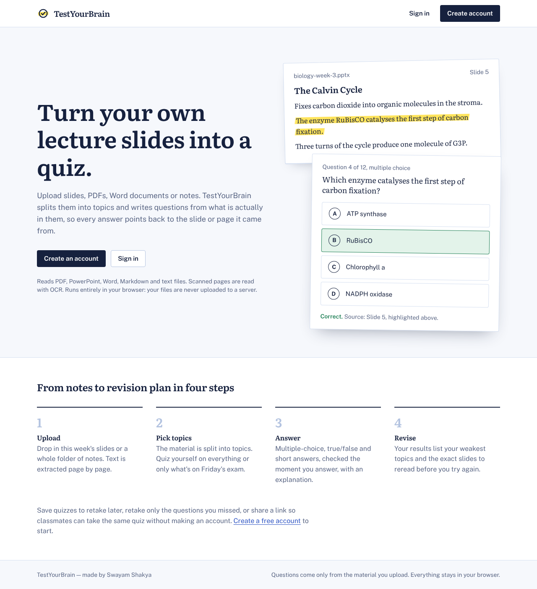

**2. He clicks "Load sample material".** Five lecture files are read in the browser. The scanned PDF is read
with OCR, and each file is split into topics.

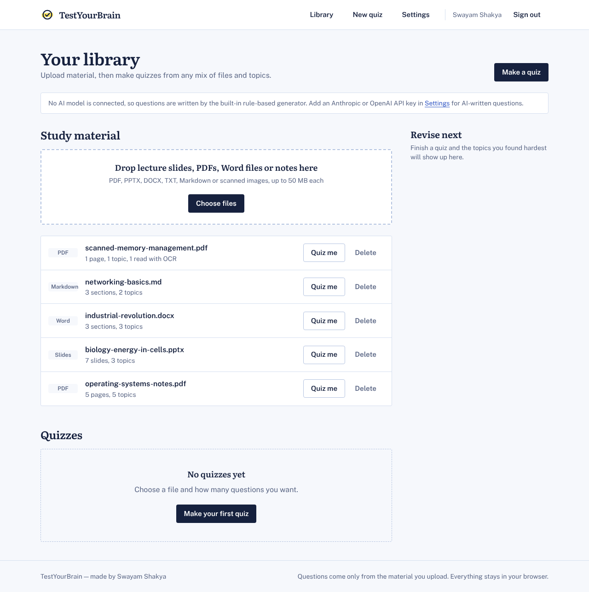

**3. He opens the slide deck** to see the topics that were found and the text taken from each slide.

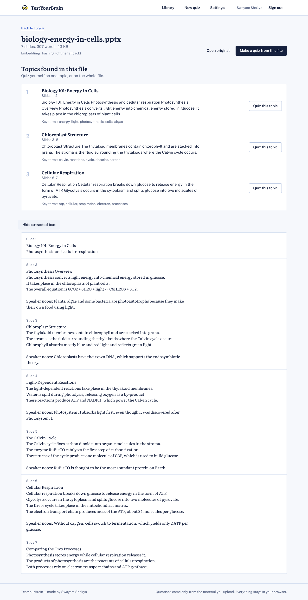

**4. He makes a 12-question quiz** from the operating-systems PDF and the biology slides.

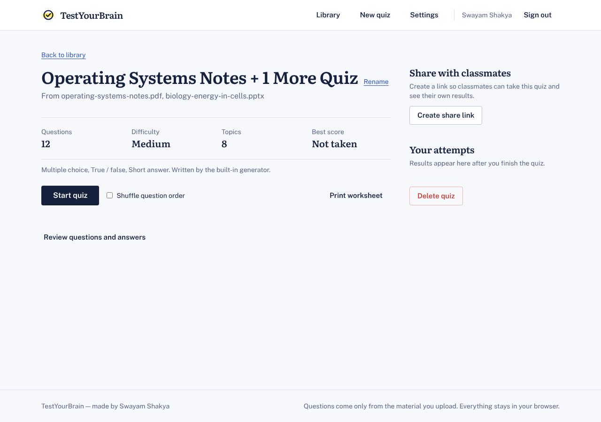

**5. Every answer points back to its source.** Clicking "Page 1 of operating-systems-notes.pdf" opens the page,
with the passage the question came from highlighted.

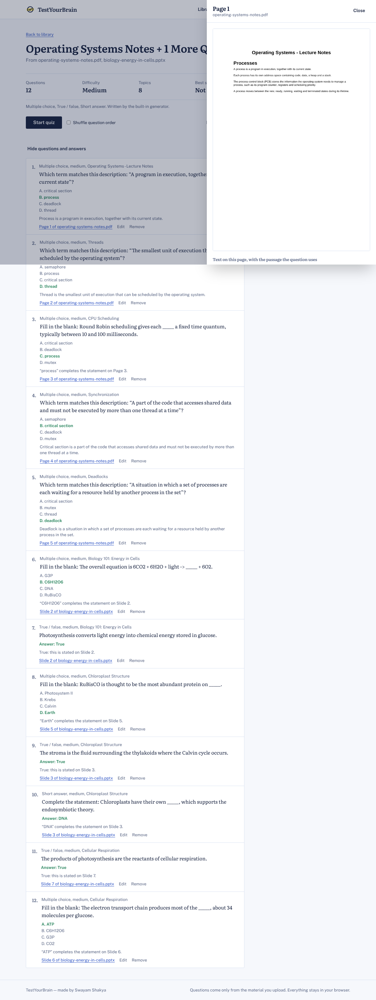

**6. He takes the quiz** and gets feedback straight after each answer: the right answer, an explanation and the
quoted passage.

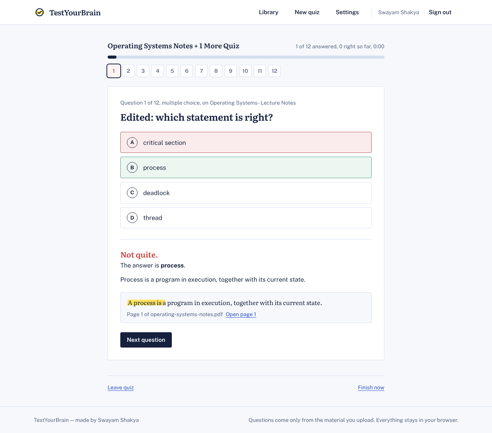

**7. His results** show the score by topic, the topics to revise and the exact pages to reread. From here he can
retake only the questions he missed, or get new questions on his weak topics.

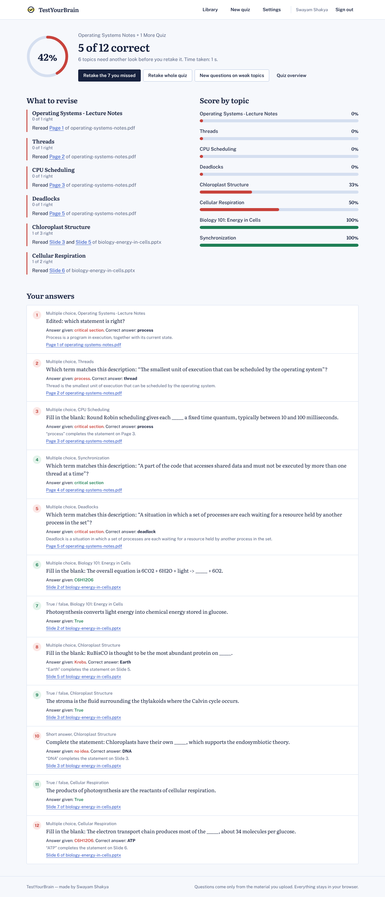

**8. He prints a worksheet** for revising on paper, with the answer key on its own page.

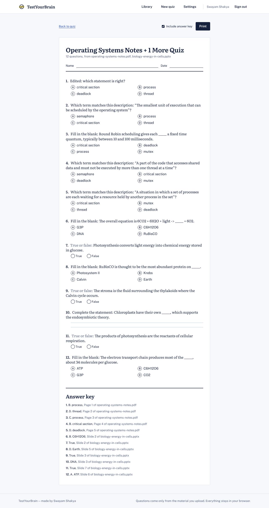

**9. He shares the quiz with Savyata.** She opens the link on her phone, types her name (no account needed),
takes the quiz and gets a link to send her result back to Swayam.

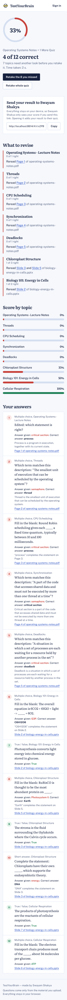

**10. Swayam opens Savyata's result link**, and her score appears under Classmates on his quiz.

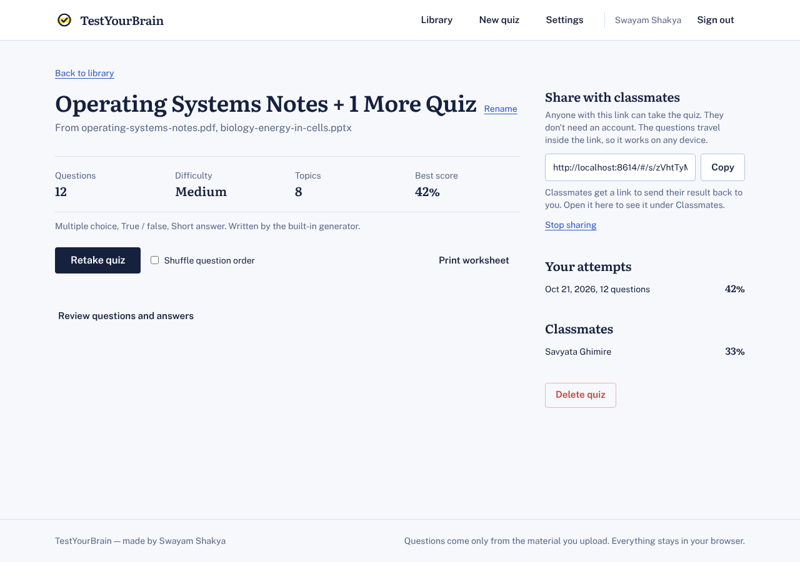

**11. Optionally, he connects an AI model** in Settings (an Anthropic or OpenAI key) to have questions written by
the model instead of the built-in generator.

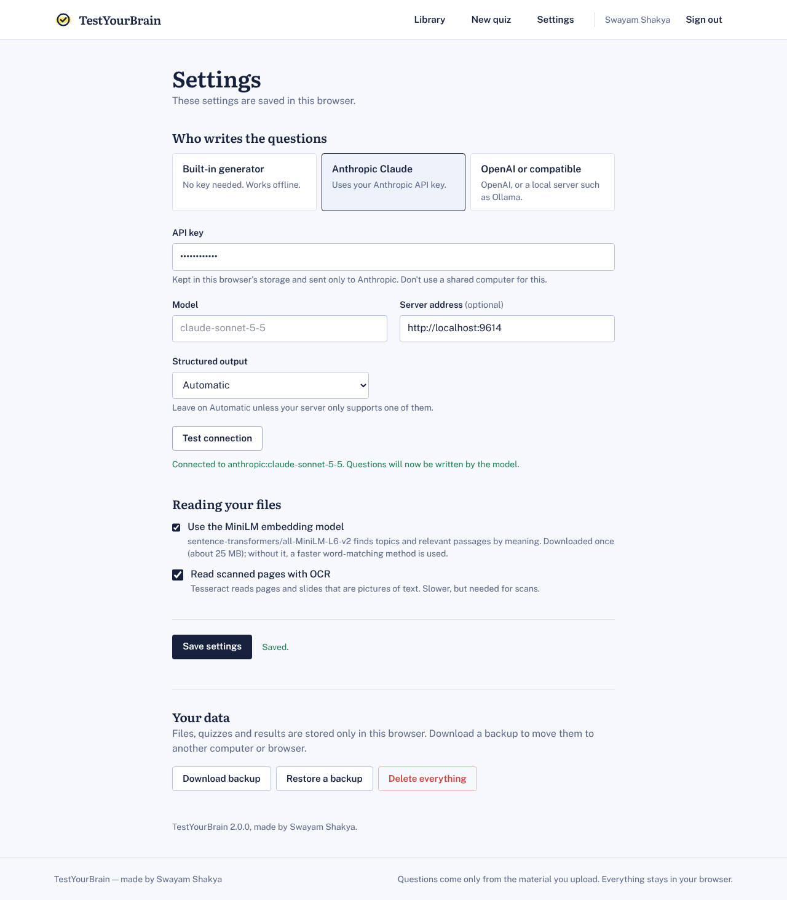

Try the same steps yourself: open the published site, create an account, click **Load sample material** and
make a quiz. To play Savyata's part, open the share link in a private window or on another device.

## Features

- **Reads PDF, PowerPoint, Word and plain-text/Markdown files**, plus images, with **Tesseract OCR** for scanned
  pages and picture-only slides.
- **Splits material into topics** by headings, or by where the meaning changes between pages and slides. With
  an AI model connected, the model groups and names the topics.
- **Writes multiple-choice, true/false and short-answer questions** at a chosen difficulty (easy, medium, hard,
  mixed) and length. Each question has the answer, an explanation and a **link to its source slide or page**.
- **Grounding check**: every question cites the passage it was written from. The citation is checked against the
  stored text, and questions that can't be traced to the material are dropped.
- **Instant feedback** while taking the quiz: the correct answer, an explanation, the source passage highlighted,
  and a side panel with the rendered page.
- **Results page** with the score by topic, the **weak topics to revise** and exactly which slides or pages to
  reread.
- **Save and retake** quizzes, either the whole quiz or only the missed questions.
- **Share with classmates** through a link. Classmates need no account and can save a copy to their own library.
  They can also send their result back to you with a second link.
- **Practise weak topics**: one click writes a fresh quiz on just the topics you got wrong, avoiding the questions
  you have already seen.
- **Edit any question** by hand, and **print a worksheet** with the answer key on a separate page.
- **A quiz timer, keyboard shortcuts** (A–D, T/F, Enter) and a layout that works on phones.
- **Works without an API key**: a built-in rule-based generator writes questions from the same retrieved passages.
  Add an Anthropic or OpenAI key in Settings to have an AI model write them instead.
- **Private by design**: files never leave your computer. Backups can be downloaded and restored in Settings.

## How it works

```
upload ─▶ extract text per page/slide (pdf.js / PowerPoint & Word XML / OCR with Tesseract.js when a page has no text)
       ─▶ chunk (port of LangChain's RecursiveCharacterTextSplitter) ─▶ embed (all-MiniLM-L6-v2 via Transformers.js,
          or hashing vectors identical to scikit-learn's HashingVectorizer)
       ─▶ split into topics (TextTiling on embeddings + headings; TF-IDF keywords) ─▶ store in IndexedDB

make quiz ─▶ spread questions over the chosen topics
          ─▶ for each topic: retrieve relevant, diverse chunks (cosine similarity + MMR)
          ─▶ the model (or the built-in generator) writes questions from those excerpts only,
             citing an excerpt id + a verbatim quote
          ─▶ the citation is checked against the chunk text (fuzzy matching); mis-cited questions are
             re-attributed and ungrounded ones dropped ─▶ saved with filename + page/slide number

take quiz ─▶ each answer is graded instantly (short answers: fuzzy match, then model grading if one is connected)
          ─▶ results grouped by topic ─▶ weak topics + slides to reread
```

How the full-stack version's pieces map onto the browser:

| Full-stack version | Web edition |
| --- | --- |
| FastAPI endpoints | `src/server/api.js`: the same paths and JSON, answered inside the page |
| PostgreSQL + ChromaDB | IndexedDB (`src/server/db.js`); vectors are stored with their chunks |
| PyMuPDF, python-pptx, python-docx | pdf.js, JSZip + the Office XML (`src/engine/extract.js`) |
| Tesseract OCR | Tesseract.js (WebAssembly) |
| sentence-transformers | Transformers.js with the same all-MiniLM-L6-v2 model |
| LangChain chat models | `fetch` calls to Anthropic or OpenAI with JSON-schema output (`src/engine/llm.js`) |
| JWT accounts | Accounts in this browser, with passwords hashed with PBKDF2 |
| Share token in the database | The quiz travels compressed inside the share link |
| Next.js + Tailwind | Preact + htm (no build step) with the same Tailwind classes, compiled to `assets/app.css` |

The engine is a line-by-line port of the Python services. `tests/parity.test.js` checks it against output
recorded from the Python code: sentence splitting, chunking, hashing vectors, topic boundaries and names, and
key terms and definitions all come out identical.

## Sharing with classmates

**Create share link** on a quiz page makes a link that contains the whole quiz in compressed form (in the part
after `#`, which browsers never send to a server). Anyone who opens it can take the quiz on their own device. At
the end they get a **result link** to send back. When you open it, their score appears under **Classmates** on
your quiz. Classmates see the quoted passage for each answer, but not your files.

© 2026 Swayam Shakya. MIT licensed, see [LICENSE](LICENSE). Bundled libraries keep their own licences
([vendor/README.md](vendor/README.md)).
